<div align="center">

<picture>
  <source media="(prefers-color-scheme: dark)" srcset="frontend/public/logo/logo-horizontal-dark.png">
  <source media="(prefers-color-scheme: light)" srcset="frontend/public/logo/logo-horizontal.png">
  
</picture>

# ToolHub-AI — Multi-Model AI, Enterprise Observability & Creator SaaS Platform

**A production-grade AI ecosystem unifying multi-provider LLM orchestration, enterprise LLM observability, an in-browser creative studio, 62 cloud tools, and a hybrid classical machine-learning engine.**

[](https://nextjs.org/)
[](https://react.dev/)
[](https://www.typescriptlang.org/)
[](https://tailwindcss.com/)
[](https://www.djangoproject.com/)
[](https://www.django-rest-framework.org/)
[](https://docs.celeryq.dev/)
[](https://redis.io/)
[](https://www.postgresql.org/)
[](https://scikit-learn.org/)
[](https://github.com/md-ajim/ToolHub-AI)
[](https://www.docker.com/)

[Executive Summary](#-executive-summary-for-hr--technical-leadership) •
[Architecture & Diagrams](#-system-architecture--technical-diagrams) •
[Enterprise Observability](#-enterprise-llm-observability--governance-suite) •
[Visual Showcase Gallery](#-product-showcase--visual-tour) •
[Engineering Highlights](#-core-engineering-innovations) •
[Machine Learning Suite](#-classical-machine-learning-engine--applied-ai) •
[Tech Stack](#-technology-stack-matrix) •
[Quickstart](#-quickstart--local-development) •
[Testing & QA](#-testing--quality-assurance) •
[Author & Contact](#-about-the-author--contact)

---

**Live product:** [toolhubai.pro](https://toolhubai.pro) &nbsp;·&nbsp; **Source:** [github.com/md-ajim/ToolHub-AI](https://github.com/md-ajim/ToolHub-AI) *(private repository — read access available on request)*

</div>

## 🎯 Executive Summary (For HR & Technical Leadership)

**ToolHub-AI** is a full-stack, distributed AI SaaS application built from the ground up to demonstrate **large-scale full-stack systems engineering**, **distributed async architecture**, **high-throughput AI/LLM infrastructure**, **applied machine learning**, and **production-grade enterprise observability**.

Spanning **~210,000 lines of first-party source** (≈108,000 TypeScript/TSX, ≈102,000 Python) across **181 Next.js route definitions** and **~356 backend API URL patterns**, ToolHub-AI converges four high-impact product domains into a cohesive multi-tenant platform:
1. **A Multi-Provider AI Workspace** supporting 15 registered provider adapters, 62 seeded models (across 11 provider kinds), real-time SSE streaming, side-by-side 3-way LLM comparison, thinking mode, and smart auto-routing.
2. **An Enterprise LLM Observability & Governance Suite** delivering granular trace telemetry, flame/span breakdowns, token & latency accounting, cost analysis, audit logging, server-side RBAC, and AI compliance pipelines.
3. **A Professional In-Browser Creative Studio** featuring a layer-based canvas (Fabric.js 7), non-destructive filter pipelines (Lena.js), inpainting alpha-masks, and generative AI (rembg U2-Net, ComfyUI, FAL).
4. **A 62-Tool Cloud Utility Suite** covering advanced image transformations, PDF processing, developer utilities, and e-commerce product staging.

### 📊 Engineering Scale & Verified Metrics

Every figure below is traceable directly to the codebase (see [Metric Verification Notes](#-metric-verification-notes)); counts are measured from source, not estimated.

| Architectural Domain | Metric / Implementation | Technical Significance |
|---|---|---|
| **Codebase Volume** | **~210,000 LOC** first-party source (TS/TSX ≈108,000, Python ≈102,000 git-tracked) | Highly modular, strictly typed full-stack architecture |
| **Frontend Architecture** | **181 Next.js route definitions** (Next.js 16.4 App Router, React 19.2, Tailwind v4) | App Router page/route handlers, theme-aware, responsive UX |
| **Backend REST & SSE** | **~356 URL patterns** across **32 Django apps** (27 registered in `INSTALLED_APPS`) | Strict domain isolation with DRF viewsets, SSE streaming, and async workers |
| **Automated Test Suite** | **1,650+ automated tests** (1,255 backend unit/integration tests + 397 Vitest frontend tests) | Regression prevention, billing safety, and ML verification |
| **AI Model Ecosystem** | **62 seeded models** across **11 provider kinds** | Unified schema with dynamic health gating, error scrubbing, and fallback |
| **LLM Provider Adapters** | **15 registered adapters** + unified Server-Sent Events gateway | Streaming protocol (`meta → delta → done`) with mid-stream abort reconciliation |
| **Enterprise Observability** | Trace telemetry, span inspection, latency percentiles (p50/p95), cost & token analytics | Real-time monitoring, trace-backed logs, unpriced cost handling |
| **Financial Ledger** | **`Reserve → Stream → Commit/Refund` state machine** with idempotency keys | Redis distributed locks + Celery sweepers to eliminate credit leaks |
| **Payment Gateways** | **4 integrated gateways** (Stripe, LemonSqueezy, bKash Tokenized, Nagad) | Global credit card processing alongside emerging-market mobile wallets |
| **Applied Classical ML** | Hybrid architecture: Custom pure-Python algorithms + `scikit-learn 1.9` backend | Churn prediction, credit burn forecaster, tool affinity recommender |
| **Creative Canvas Engine** | **31 registered AI image operations** + Fabric.js 7 & Lena.js canvas | Layer reordering, non-destructive filter chains, and inpainting masks |
| **Async Services** | **6 Docker Compose services** (Next.js, Django/Gunicorn, Celery, Beat, Redis, Postgres) | Event-driven processing + optional Cloudflare Zero-Trust Tunnel profile |

---

## 🏗️ System Architecture & Technical Diagrams

ToolHub-AI is built on an asynchronous, event-driven modular architecture engineered for sub-second streaming, fault-tolerant third-party integrations, and strict financial consistency. Below are the complete architectural source definitions.

### 1. High-Level Multi-Tier System Topology

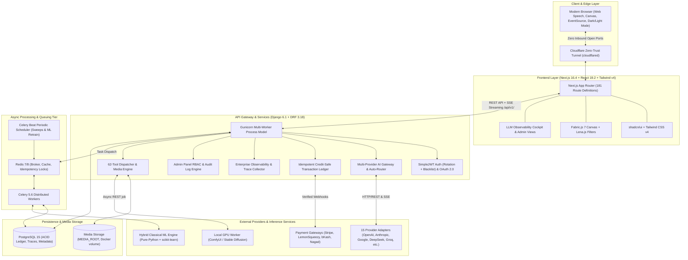

---

### 2. Multi-Provider AI Streaming & Abort Reconciliation Protocol

Handling generative AI streams requires handling mid-stream client disconnects and upstream provider failures gracefully without corrupting user credit balances.

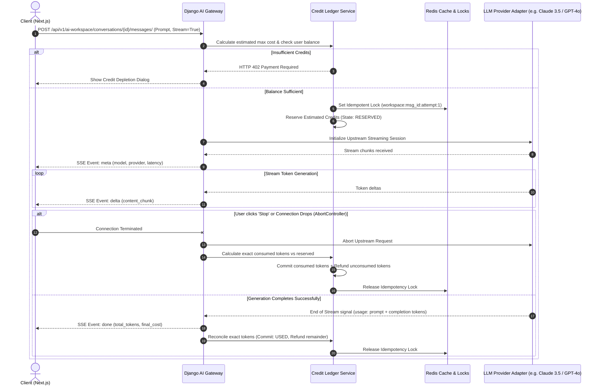

---

### 3. Credit-Safe Financial Ledger Architecture (`Reserve → Stream → Commit/Refund`)

To eliminate duplicate billing and protect users against network drops, all transactions follow an idempotent two-phase settlement pattern backed by automated Celery sweepers:

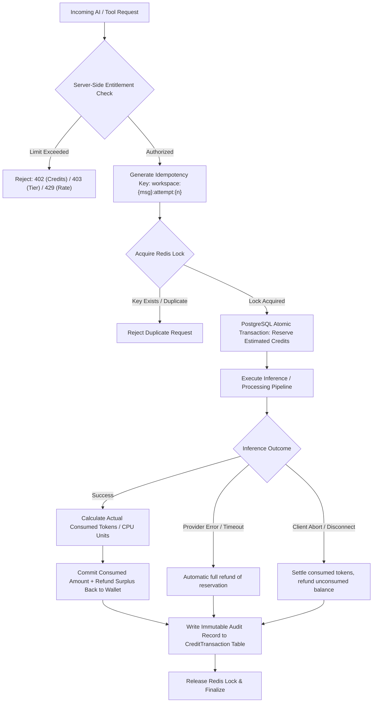

---

### 4. Next.js 16 App Router & JWT Authentication Lifecycle

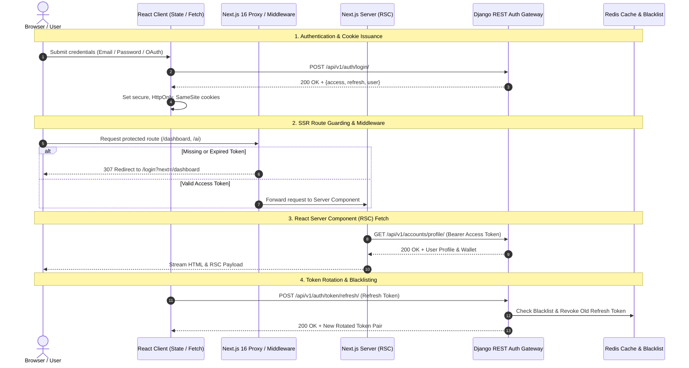

---

## 🔍 Enterprise LLM Observability & Governance Suite

Mounted under `/enterprise/` and powered by `apps.enterprise_observability`, this module delivers enterprise-grade transparency into every LLM interaction:

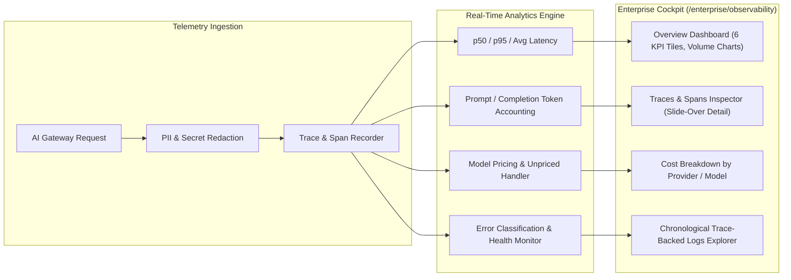

### Key Capabilities:
- **Trace & Request Telemetry:** Deep dive into every prompt, token breakdown, duration, time-to-first-token (TTFT), request/response headers, and metadata.
- **Provider & Model Health Matrix:** Live monitoring of error rates, p50/p95 latency distributions, and active throughput across all 15 provider adapters.
- **Cost & Token Economics:** Real-time token aggregation and multi-currency cost calculation with explicit `Unpriced` classification (never misleading $0.00).
- **Security & PII Scrubbing:** High-speed token redaction scrubbing API keys (`sk-...`, `hf_...`), authorization headers, and confidential customer payloads before persistence.
- **Admin RBAC & Audit Trail:** Server-enforced `AdminRole` controls and immutable `AuditLog` records for all administrative mutations.

---

## 📸 Product Showcase & Visual Tour

### 1. Multi-Model AI Chat Workspace (`/ai`)
A centralized AI powerhouse offering real-time Server-Sent Events (SSE) streaming, context-preserving model switching, multi-modal file attachments (code, documents, images), reasoning "Think Mode" toggling, and multi-model comparison.

| Light Mode Workspace | Dark Mode Workspace |
|:---:|:---:|
| <a href="frontend/public/Images/ai-workspace-light.jpg">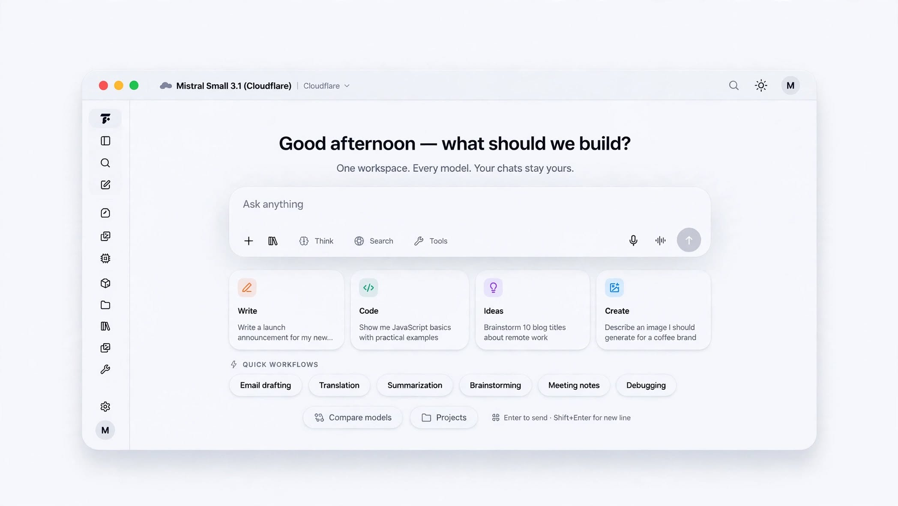</a> | <a href="frontend/public/Images/ai-workspace-dark.jpg">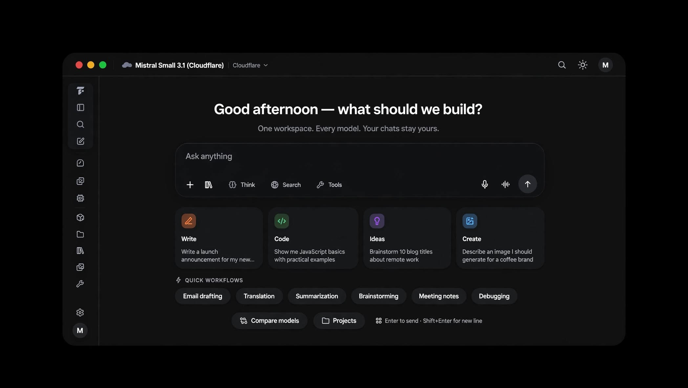</a> |

*Features: multi-control composer, drag-and-drop file library reuse, latency tracking, auto-routing fallback, and 3-way side-by-side LLM compare.*

---

### 2. Pro In-Browser Creative Studio (`/tools/image-editor`)
A full-featured graphic design and AI transformation canvas built on Fabric.js 7 and Lena.js, featuring layer hierarchies, non-destructive filter chains, inpainting brush masks, and e-commerce staging presets.

| Light Mode Canvas | Dark Mode Canvas |
|:---:|:---:|
| <a href="frontend/public/Images/image-editor-light.png">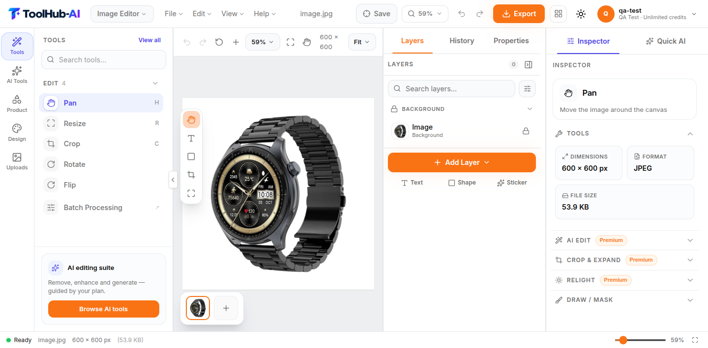</a> | <a href="frontend/public/Images/image-editor-dark.png">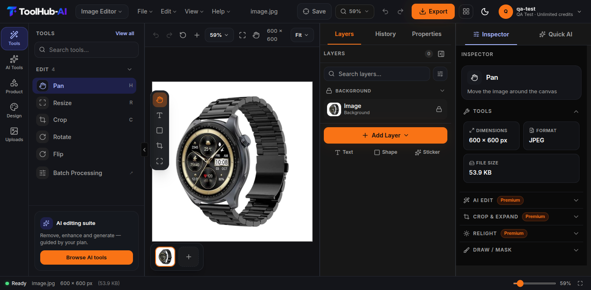</a> |

---

### 3. Integrated AI Image Studio & Background Segmentation
Deep generative AI integration allowing background removal (rembg U2-Net), AI relighting, generative fill, and instant product staging directly on active canvas layers.

| Generative AI Tool Rail | U2-Net Background Removal Panel |
|:---:|:---:|
| <a href="docs/qa/screenshots/21-editor-ai-open.jpg">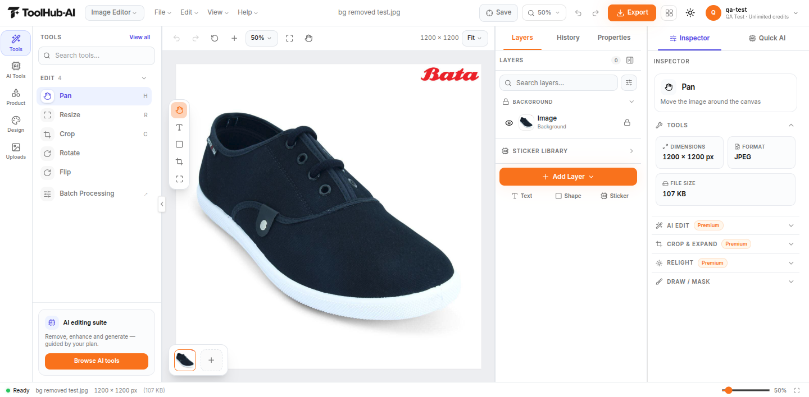</a> | <a href="docs/qa/screenshots/22-editor-bgremove-panel.jpg">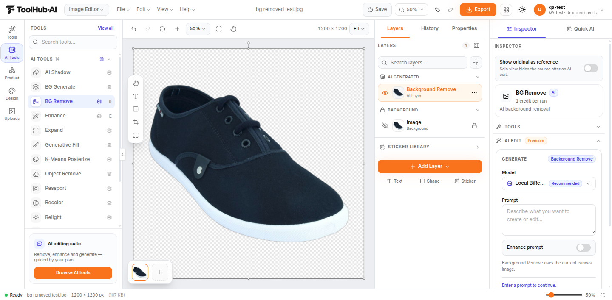</a> |

---

### 4. Models Directory & Multi-Provider Registry (`/ai/models`)
A transparent model catalogue displaying real-time provider health, capability matrices (reasoning, vision, function calling, audio), context window size, and pricing tiers.

| AI Model Ecosystem Directory | Smart Export & Multi-Format Presets |
|:---:|:---:|
| <a href="docs/qa/screenshots/08-ai-models.jpg">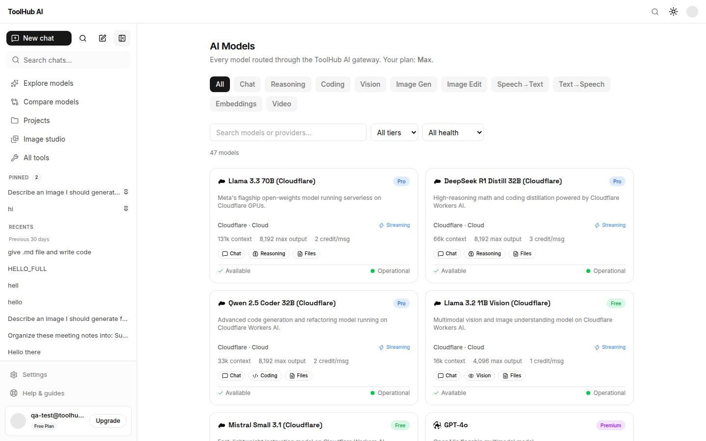</a> | <a href="docs/qa/screenshots/24-editor-export.jpg">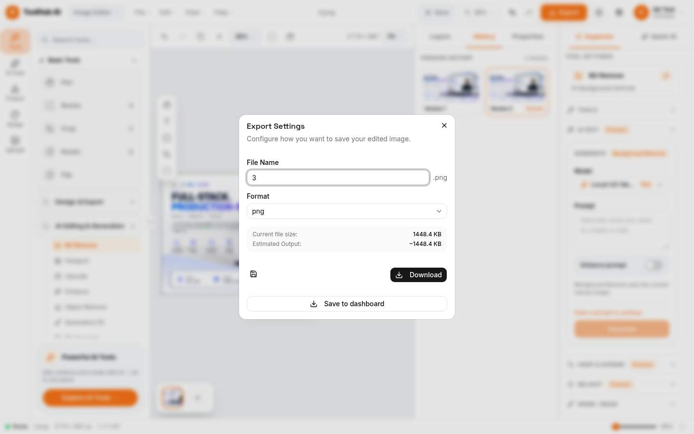</a> |

---

### 5. Production Dashboard, Analytics & Financial Billing (`/dashboard`)
Comprehensive user cockpit monitoring credit allocation, storage consumption, Celery task statuses, and multi-gateway billing history.

| Dashboard Analytics & Activity Feed | Subscriptions & Credit-Safe Billing Ledger |
|:---:|:---:|
| <a href="docs/qa/screenshots/05-dash.jpg">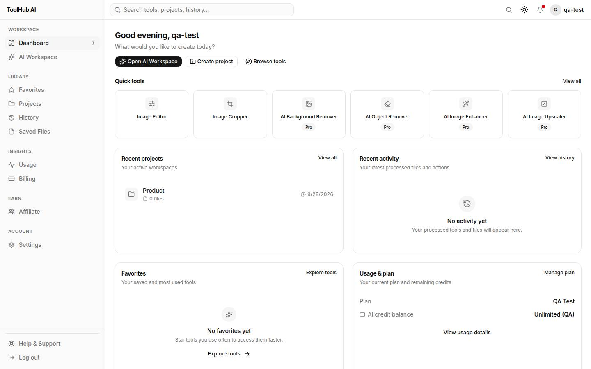</a> | <a href="docs/qa/screenshots/07-dash-billing.jpg">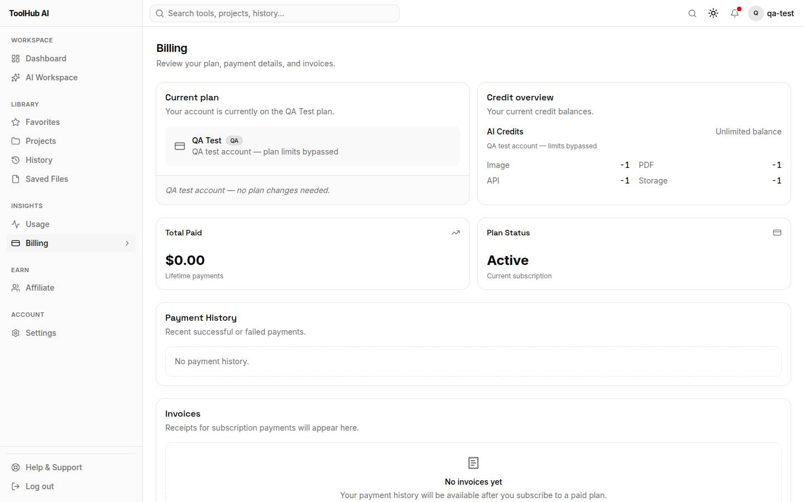</a> |

| Granular Credit Usage Telemetry | High-Throughput Batch Processing Engine |
|:---:|:---:|
| <a href="docs/qa/screenshots/06-dash-usage.jpg">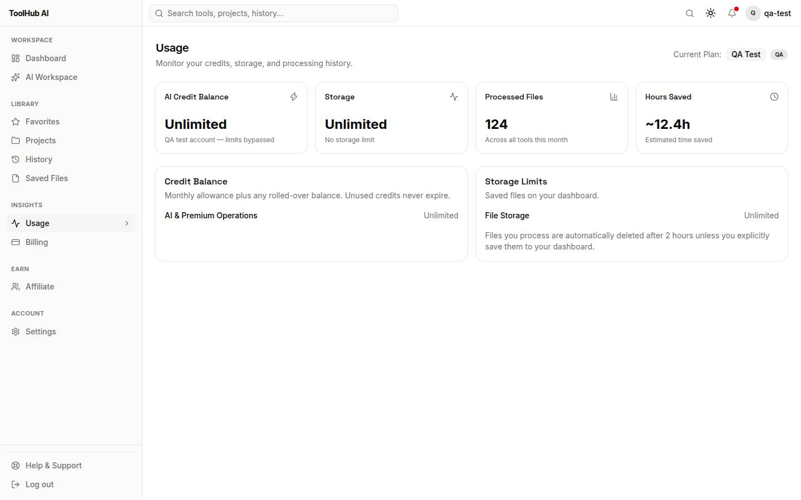</a> | <a href="docs/qa/screenshots/11-batch-processing.jpg">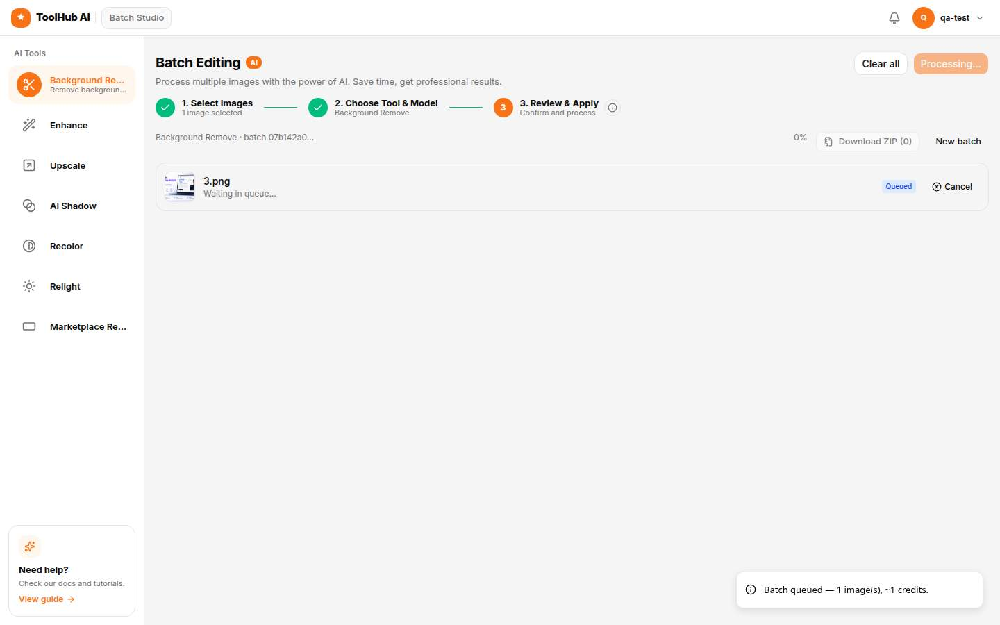</a> |

---

### 6. Authentication Security & Multi-Device Responsive UI
Full authentication lifecycle and responsive mobile viewports optimized across desktop, tablet, and smartphone form factors.

| Secure Authentication & Session Gate | Mobile Responsive Viewport (390px) |
|:---:|:---:|
| <a href="docs/qa/screenshots/01-login-filled.jpg">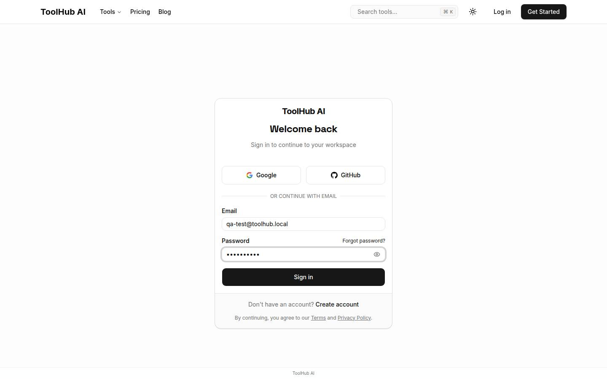</a> | <a href="docs/qa/screenshots/30-mobile390-batch.jpg">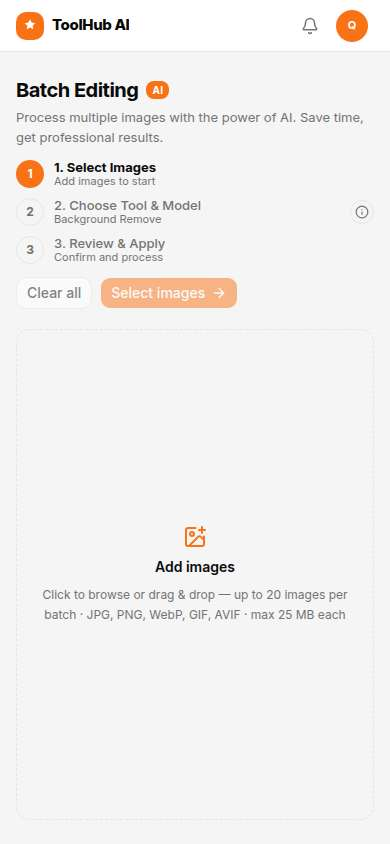</a> |

| Canvas History Stack & Timeline | Non-Destructive Layer Reversion (Undo/Redo) |
|:---:|:---:|
| <a href="docs/qa/screenshots/23b-editor-history.jpg">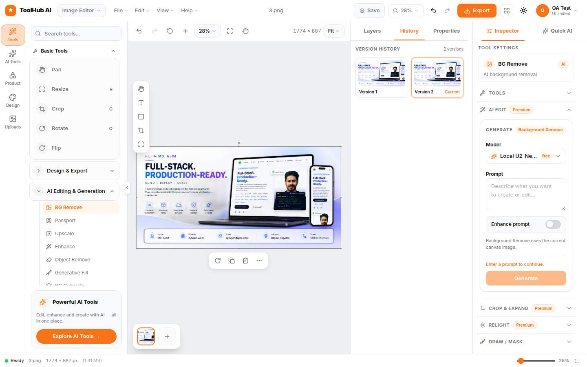</a> | <a href="docs/qa/screenshots/41-after-undo.jpg">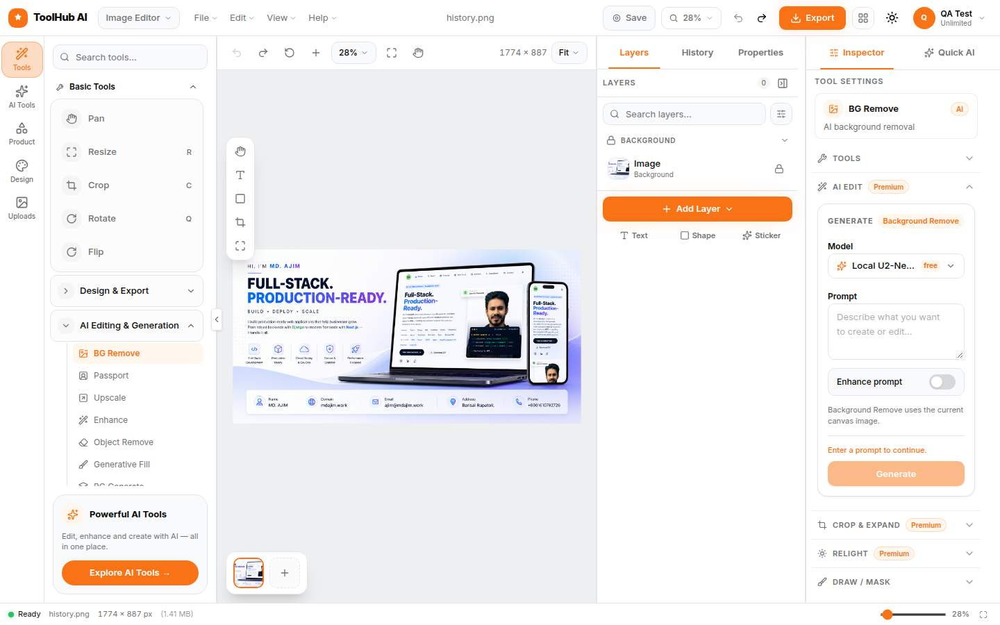</a> |

---

## ⚡ Core Engineering Innovations

### 1. Multi-Provider LLM Gateway with Resilient Auto-Routing
- **15 Standardized Provider Adapters:** Decoupled adapters translate heterogeneous upstream schemas (OpenAI, Anthropic Messages API, Google Gemini REST, DeepSeek, Mistral, Groq, Cohere, Ollama) into a unified internal data contract.
- **Circuit Breaker & Live Verification (`verify_models --live`):** Selectors display only models that pass synthetic round-trip verification. Degraded providers are automatically quarantined.
- **Side-by-Side Model Compare (`/ai/compare`):** Uses an asynchronous thread-and-queue fan-out engine to stream responses from up to 3 models simultaneously, displaying real-time TTFT and throughput benchmarks.

### 2. Credit-Safe Ledger & Multi-Gateway Billing
- **Reserve-then-settle design:** A request reserves an estimated maximum, commits actual consumed tokens, and refunds the remainder. Redis idempotency keys (`workspace:{msg_id}:attempt:{n}`) prevent duplicate deductions.
- **Server-Side Security Enforcement:** All plan entitlements, tool permissions, and burst rate limits are validated strictly on the backend (HTTP 402/403/429). The frontend never makes authorization decisions.
- **Hybrid Global & Regional Payment Engine:** Webhook-driven state machines support credit cards (Stripe, LemonSqueezy) alongside regional mobile wallets (bKash Tokenized Checkout, Nagad).

### 3. Layer-Based In-Browser Creative Studio (Fabric.js 7 & Lena.js)
- **Non-Destructive Canvas Architecture:** Powered by Fabric.js 7 coupled with Lena.js image filters, supporting bounded undo/redo history (50 steps), alignment guides, and layer ordering.
- **Brush-Mask Inpainting:** Users paint directly over canvas objects to generate precise alpha-masks for generative inpainting or object removal.
- **eCommerce Automation Rail (`apps.ecommerce_studio`):** Specialized 1-click tools for product photography, ghost mannequin extraction, fashion model generation, and marketplace presets (Amazon, Shopify, Etsy, eBay).

### 4. Comprehensive 62-Tool Cloud Utility Suite
- Consolidated tool suite across 15 categories, verified in `frontend/src/constants/centralToolRegistry.ts`:
  - **Image & AI creative tools (41):** Resizing, crop/rotate/flip, WebP/AVIF compression, passport photo generator, watermarking, background removal, inpainting, and relighting.
  - **PDF Operations (8):** Client- and server-side merging, page splitting, compression, password protection/unlock, and format conversion.
  - **Text, SEO & Developer Utilities (13):** Text cleaning, duplicate removal, QR code and favicon generation, link shortening, password generation, meta/Open Graph/robots/sitemap generators, and a resume builder.

---

## 🧠 Classical Machine Learning Engine & Applied AI

ToolHub-AI features a hybrid machine-learning architecture: a **pure-mathematical implementation** designed from first principles alongside a production-standard **`scikit-learn 1.9` backend** with backward-compatible JSON artifact support.

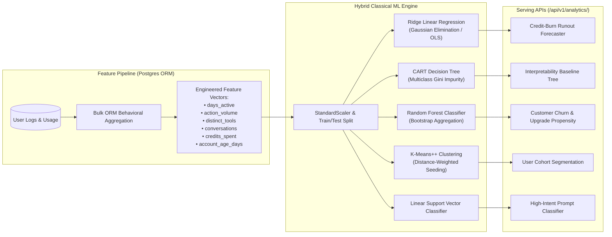

### ML Engine Highlights:
1. **Ridge-Stabilized Linear Regression:** Built using Gaussian elimination with L2 ridge stabilization to avoid singular matrix inversion. Powers credit burn runout forecasting.
2. **Decision Trees & Random Forest:** Recursive binary splitting on multiclass Gini impurity, bootstrap aggregation, and permutation feature importance for user churn and upgrade propensity.
3. **K-Means++ Clustering:** Probabilistic distance-weighted initialization with deterministic seeding to cluster tool affinity (Jaccard co-occurrence matrix) and user behavioral cohorts.
4. **Text Vectorizers & Preprocessing:** Pure CountVectorizer and TF-IDF vectorizers with n-gram support and stop-word filtering for prompt classification.
5. **Zero-Downtime Serving & Compatibility:** Seamlessly deserializes both legacy custom JSON artifacts and modern base64-encoded sklearn models with zero API downtime.

---

## 💻 Technology Stack Matrix

```
Frontend:
  ├── Framework: Next.js 16.4 (App Router, Turbopack, Webpack build)
  ├── Core: React 19.2, TypeScript 5.x
  ├── Styling: Tailwind CSS v4, shadcn/ui, Lucide Icons
  ├── Creative Canvas: Fabric.js 7, Lena.js (filters), react-advanced-cropper
  └── Streaming & State: Server-Sent Events (SSE), React Context, next-themes

Backend & Distributed Services:
  ├── Language: Python 3.12
  ├── Web Framework: Django 6.1, Django REST Framework (DRF) 3.18
  ├── WSGI Server: Gunicorn 23.0 (multi-worker process model)
  ├── Task Queuing: Celery 5.6 (distributed asynchronous worker execution)
  ├── Scheduler: Celery Beat (periodic ledger sweepers, retrain jobs)
  ├── Caching & Locks: Redis 7/8 (broker, cache, idempotency locks)
  └── Database: PostgreSQL 15 (relational schema with ACID transactions)

AI Inference & Enterprise Services:
  ├── Multi-Model Gateway: 15 registered provider adapters (OpenAI, Anthropic, Google, DeepSeek, etc.)
  ├── Enterprise Observability: Trace collector, span analytics, cost engine, latency distributions
  ├── Local GPU Worker: ComfyUI (Stable Diffusion workflow execution)
  ├── Image Processing: Pillow 12, rembg (MIT-licensed U2-Net background removal), pypdf
  └── Machine Learning: scikit-learn 1.9 + pure-Python mathematical algorithms

Security & Payment Infrastructure:
  ├── Authentication: SimpleJWT (rotation + blacklist), Google & GitHub OAuth 2.0
  ├── Ingress Protection: Cloudflare Zero-Trust Tunnel (cloudflared)
  └── Payment Gateways: Stripe, LemonSqueezy, bKash (Tokenized), Nagad
```

---

## 📂 Project Organization & Directory Layout

```
ToolHub-AI/
├── frontend/                       # Next.js 16.4 App Router Frontend (~108k LOC)
│   ├── src/
│   │   ├── app/                    # 181 route definitions (marketing, /ai, /enterprise, /admin, /tools)
│   │   ├── components/
│   │   │   ├── ai-workspace/       # LLM chat composer, thread, model selector, compare
│   │   │   ├── editor/             # Fabric.js canvas, layers panel, filter controls, tool rail
│   │   │   ├── dashboard/          # Telemetry, billing cards, file browser
│   │   │   └── ui/                 # Accessible primitives built on shadcn/ui
│   │   ├── features/
│   │   │   ├── enterprise/         # Observability, compliance, RFP workspaces & sidebars
│   │   │   └── admin/              # RBAC administration gates, tables, breadcrumbs
│   │   ├── services/               # Strongly-typed API clients (AI, billing, observability)
│   │   └── constants/              # Central registry of 62 tools, model capability matrix
│   └── public/                     # Screenshots, branding, logos, vector assets
│
├── backend/                        # Django 6.1 REST Application (~102k LOC)
│   ├── apps/                       # 32 Django app modules (27 registered in INSTALLED_APPS)
│   │   ├── ai_workspace/           # 15 provider adapters, SSE streaming gateway, chat models
│   │   ├── enterprise_observability# Traces, spans, token accounting, latency percentiles
│   │   ├── enterprise_compliance/  # Policy inspector, PII scrubbing, audit rules
│   │   ├── enterprise_rfp/         # Document extraction, question retrieval, RFP generator
│   │   ├── admin_panel/            # Server-enforced RBAC, AdminRole, system inspection
│   │   ├── admin_logs/             # Immutable audit logging for mutations and outcomes
│   │   ├── ecommerce_studio/       # Marketplace presets, brand kits, export workflows
│   │   ├── subscriptions/          # Plans, credit wallets, atomic credit-transaction ledger
│   │   ├── billing/                # Webhooks & state machines (Stripe, LemonSqueezy, bKash, Nagad)
│   │   ├── analytics/              # ML library, churn prediction, user clustering, recommender
│   │   ├── authentication/         # JWT rotation, OAuth callbacks, OTP verification
│   │   ├── image_tools/            # Pillow, rembg U2-Net image transformations
│   │   ├── pdf_tools/              # pypdf operations (merge, split, encrypt, convert)
│   │   └── developer_tools/        # QR generator, hash utilities, formatters
│   ├── config/                     # Core settings, WSGI/ASGI handlers, Celery config
│   └── requirements/               # Dependency specification (base.txt)
│
├── comfyui/                        # Local GPU workflow configurations & model weights
├── docs/                           # Architecture specifications, diagrams & QA audits
│   ├── diagrams/                   # High-resolution system & sequence architecture diagrams
│   ├── 03-system-architecture.md   # System design & database specifications
│   ├── 11-payment-subscription-architecture.md  # Idempotent ledger & payment state machines
│   ├── 32-ai-multi-model-workspace-architecture-v2.0.md  # SSE gateway & adapter specification
│   └── qa/screenshots/             # Visual QA audit artifacts
├── docker-compose.yml              # 6-service container orchestration (+ optional cloudflared)
└── .env.example                    # Environment variable template
```

---

## 🚀 Quickstart & Local Development

### Option 1: Docker Compose (Recommended)

Run the full stack (Frontend, Backend/Gunicorn, Postgres, Redis, Celery worker, and Celery Beat) with a single command. Migrations and initial seeds execute automatically on startup:

```bash
# 1. Clone the repository
git clone https://github.com/md-ajim/ToolHub-AI.git
cd ToolHub-AI

# 2. Configure environment credentials
cp .env.example .env
# Open .env and supply your SECRET_KEY and any AI/payment keys you need

# 3. Build and launch the 6 default services
docker compose up -d --build

# Access the app:
# Web app:  http://localhost:32768   (host port = FRONTEND_PORT, default 32768)
```

> **Networking note:** Only the frontend is published to the host by default. Next.js reverse-proxies `/api/*` and `/media/*` to the `backend` service (see `frontend/next.config.ts`), so the REST API is reachable at `http://localhost:32768/api/v1/`. An optional `cloudflared` service is available via `docker compose --profile cloudflare up -d`.

---

### Option 2: Native Bare-Metal Development

#### Prerequisites
- Node.js 20+ & npm
- Python 3.12+
- PostgreSQL 15 & Redis 7 running locally (or `docker compose up -d db redis`)

#### 1. Backend Setup (Django + Celery)
```bash
cd backend
python -m venv venv
source venv/bin/activate  # On Windows: venv\Scripts\activate

pip install -r requirements/base.txt
cp ../.env.development .env

# Run database migrations and seed plans + AI models
python manage.py migrate
python manage.py seed_plans
python manage.py seed_ai_models
python manage.py seed_marketplace_presets

# Start the API server
python manage.py runserver 0.0.0.0:8000
```

In a separate terminal, launch the background task worker:
```bash
cd backend
source venv/bin/activate
celery -A config worker --loglevel=info
```

#### 2. Frontend Setup (Next.js 16)
```bash
cd frontend
npm install
npm run dev
# Set BACKEND_URL=http://localhost:8000 in your frontend environment,
# then navigate to http://localhost:3000
```

---

## 🧪 Testing & Quality Assurance

ToolHub-AI maintains a comprehensive automated testing suite with **over 1,650 tests** spanning both frontend and backend layers:

| Suite | Command | Test Count / Coverage |
|---|---|---|
| **Frontend Suite (Vitest)** | `cd frontend && npm test` | **397 unit & component tests** (state, formatting, tools, shell) |
| **Backend Unit & Integration** | `cd backend && pytest tests/unit/` | **1,255 tests** covering billing safety, ML, observability, auth |
| **Backend ML Engine Suite** | `cd backend && pytest tests/unit/apps/analytics/test_ml_suite.py` | **48 passing tests** (models, tuning, metrics, serialization) |
| **Billing Safety Suite** | `cd backend && pytest tests/unit/apps/billing/test_billing_safety.py` | Idempotency locks, stale sweeps, partial abort reconciliations |
| **Total Test Suite** | Full Stack Coverage | **1,650+ Automated Tests** |

---

## 🔒 Security & Hardening Highlights

- **Reduced Inbound Attack Surface:** Deployed with the optional **Cloudflare Tunnel (`cloudflared`)** profile, allowing full edge ingress without opening direct public inbound ports to the backend or database.
- **Defensive JWT Authentication:** Short-lived access tokens with refresh token rotation and explicit blacklisting on rotation and logout (`rest_framework_simplejwt.token_blacklist`).
- **Payment Webhook Verification:** Stripe and LemonSqueezy webhooks are verified via HMAC/secret signature checks, and duplicate events are de-duplicated through database-level idempotency records (`billing/webhooks_multi.py`).
- **Server-Side RBAC & Authorization:** Plan access, tool permissions, rate limits, and administrative views are validated strictly on the backend (`apps.admin_panel.services.has_admin_permission`); client UI guards are purely decorative.
- **Sandboxed Content Rendering:** AI Markdown is rendered by a custom structured renderer emitting React nodes and showing HTML in a sandboxed preview — never injected into the application DOM (`frontend/src/components/ai-workspace/MarkdownContent.tsx`).

---

## 📐 Metric Verification Notes

The metrics in this README were re-measured and verified against the repository source code:

| Metric | Source-Verified Value | Measurement Methodology |
|---|---|---|
| **TypeScript / TSX LOC** | **107,918** | `find frontend/src -type f \( -name "*.ts" -o -name "*.tsx" \) \| xargs wc -l` |
| **Python LOC** | **102,317** (96,507 core) | `find backend -type f -name "*.py" \| xargs wc -l` (excl. pycache & venvs) |
| **Total First-Party LOC** | **~210,000 LOC** | Combined first-party frontend and backend codebase volume |
| **Frontend Routes** | **181** | Count of `page.tsx` and `route.ts` files under `frontend/src/app` |
| **Backend URL Patterns** | **~356** | `path()` and `re_path()` declarations across Django `urls.py` modules |
| **Django Apps** | **32 apps (27 registered)** | App directories in `backend/apps/`; registered in `settings.base.py` |
| **Automated Tests** | **1,650+** | 1,255 backend pytest cases + 397 frontend Vitest test cases |
| **Seeded Models / Providers**| **62 models / 11 providers**| Seeded via `apps.ai_workspace.management.commands.seed_ai_models` |
| **Provider Adapters** | **15 adapters** | Registered adapters in `apps.ai_workspace.providers` |
| **Central Tools** | **62 tools** | Registered in `frontend/src/constants/centralToolRegistry.ts` |
| **AI Image Operations** | **31 operations** | Registered in `backend/apps/ai_tools/registry.py` |

---

## 👨‍💻 About the Author & Contact

**MD AJIM**  
*Full-Stack Systems Engineer (Django | Next.js | Distributed AI | DevOps)*  
Barisal, Bangladesh • Open to Global Relocation & Remote Opportunities  

- 🌐 **Portfolio Website:** [mdajim.work](http://mdajim.work)
- 💼 **LinkedIn Profile:** [linkedin.com/in/md-ajim](https://www.linkedin.com/in/md-ajim/)
- 🐙 **GitHub Profile:** [github.com/md-ajim](https://github.com/md-ajim)
- 📧 **Direct Email:** [ajim@mdajim.work](mailto:ajim@mdajim.work)

---

<div align="center">

*Engineered with precision for performance, security, and developer joy.*

</div>
