<div align="center">


# ToolHub-AI — Multi-Model AI & Creator SaaS Platform

**A full-stack AI ecosystem unifying multi-provider LLM orchestration, a layered canvas media studio, 62 cloud tools, and a dependency-free Python machine-learning library.**

[](https://nextjs.org/)
[](https://react.dev/)
[](https://www.typescriptlang.org/)
[](https://tailwindcss.com/)
[](https://www.djangoproject.com/)
[](https://www.django-rest-framework.org/)
[](https://docs.celeryq.dev/)
[](https://redis.io/)
[](https://www.postgresql.org/)
[](https://www.docker.com/)

[Executive Summary](#-executive-summary-for-hr--technical-leadership) •
[System Architecture](#-system-architecture--technical-diagrams) •
[Screenshots Gallery](#-product-showcase--visual-tour) •
[Engineering Highlights](#-core-engineering-innovations) •
[Machine Learning Suite](#-pure-python-classical-machine-learning-engine) •
[Tech Stack](#-technology-stack-matrix) •
[Quickstart](#-quickstart--local-development) •
[Testing & QA](#-testing--quality-assurance) •
[Author & Contact](#-about-the-author--contact)

---

**Live product:** [toolhubai.pro](https://toolhubai.pro) &nbsp;·&nbsp; **Source:** [github.com/md-ajim/ToolHub-AI](https://github.com/md-ajim/ToolHub-AI) *(private repository — read access available on request)*

</div>

## 🎯 Executive Summary (For HR & Technical Leadership)

**ToolHub-AI** is a full-stack AI SaaS application built from the ground up to demonstrate **full-stack engineering**, **distributed system design**, **AI/LLM infrastructure**, **applied machine learning**, and **production-oriented DevOps**.

Spanning **~113,000 lines of first-party source** (≈66,000 TypeScript/TSX, ≈47,000 Python) across 146 frontend route definitions and ~190 backend API endpoints, ToolHub-AI converges three domains into a single unified account:
1. **A Multi-Provider AI Workspace** supporting 15 registered provider adapters, 62 seeded models (across 11 providers), real-time SSE streaming, side-by-side LLM comparison, and smart auto-routing.
2. **A Professional In-Browser Creative Studio** with a layer-based canvas (Fabric.js), non-destructive canvas filter pipelines (Lena.js), inpainting masks, and local/cloud generative AI (ComfyUI, rembg U2-Net, FAL).
3. **A 62-Tool Cloud Utility Suite** covering advanced image transformation, PDF manipulation, text processing, SEO diagnostics, and developer utilities.

### 📊 Engineering Scale & Metrics

Every figure below is traceable to the repository (see the [metric verification notes](#-metric-verification-notes)); counts are measured from source, not estimated.

| Architectural Domain | Metric / Implementation | Technical Significance |
|---|---|---|
| **Codebase Volume** | **~113,000 LOC** first-party source (TS/TSX ≈66,000, Python ≈47,000, git-tracked) | Large, modular codebase with strict type-safety on the frontend |
| **Frontend Architecture** | **146 Next.js route definitions** (Next.js 16 App Router, React 19, Tailwind v4) | Responsive, theme-aware UI with route-level code organization |
| **Backend REST & SSE** | **~190 API endpoints** across **28 Django app modules** (23 registered in `INSTALLED_APPS`) | Domain separation with lightweight custom DRF views |
| **AI Model Ecosystem** | **62 seeded models** across **11 provider kinds** | Standardized LLM abstraction layer with health gating and auto-fallback |
| **LLM Provider Adapters** | **15 registered adapters** (incl. a mock test adapter) + unified SSE gateway | Streaming protocol (`meta → delta → done`) with mid-stream abort reconciliation |
| **Financial Ledger** | **`Reserve → Stream → Commit/Refund` state machine** with idempotency keys | Designed to avoid credit leaks on disconnect or upstream failures |
| **Payment Infrastructure** | **4 gateways** (Stripe, LemonSqueezy, bKash Tokenized, Nagad) | Card processing plus regional mobile-wallet support |
| **Applied Classical ML** | Dependency-free Python ML library (~10 algorithms; no scikit-learn/pandas) | Lean Docker images; powers churn, upgrade propensity, clustering, and forecasting |
| **Creative Canvas Engine** | **31 registered AI image operations** surfaced via the editor rail, Batch Studio, and tool pages | In-browser canvas manipulation, layer ordering, and non-destructive filter chains |
| **Async Services** | **6 Docker Compose services** (Next.js, Django/Gunicorn, Celery worker, Celery Beat, Redis, Postgres) | Event-driven processing; optional zero-inbound Cloudflare Tunnel profile |

---

## 📸 Product Showcase & Visual Tour

### 1. Multi-Model AI Chat Workspace (`/ai`)
A centralized AI powerhouse offering real-time Server-Sent Events (SSE) streaming, context-preserving model switching, multi-modal file attachments (code, documents, images), reasoning "Think Mode" toggling, and multi-model comparison.

| Light Mode Workspace | Dark Mode Workspace |
|:---:|:---:|
| 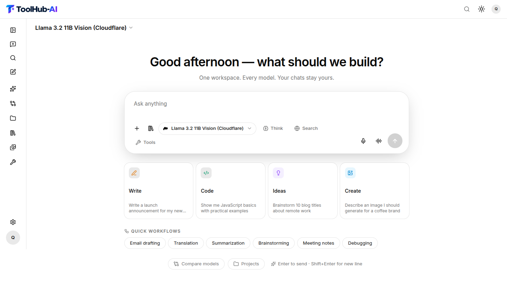 | 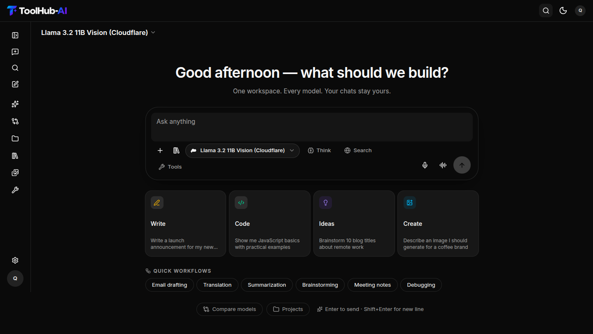 |

*Features: multi-control composer, drag-and-drop file library reuse, latency tracking, auto-routing fallback, and 3-way side-by-side LLM compare (up to 3 models).*

---

### 2. Pro In-Browser Creative Studio (`/tools/image-editor`)
A full-featured graphic design and AI transformation canvas built on Fabric.js and Lena.js, featuring layer hierarchies, non-destructive filter chains, inpainting brush masks, and e-commerce staging presets.

| Light Mode Canvas | Dark Mode Canvas |
|:---:|:---:|
| 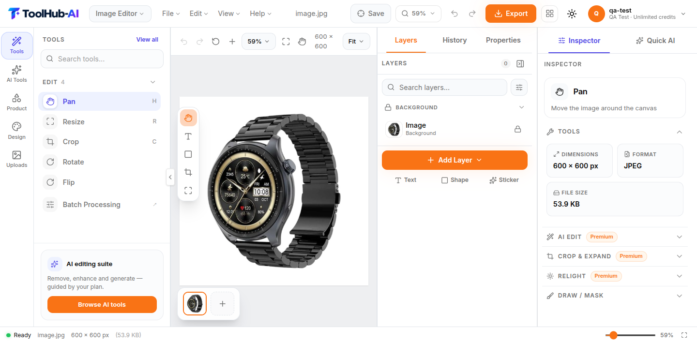 | 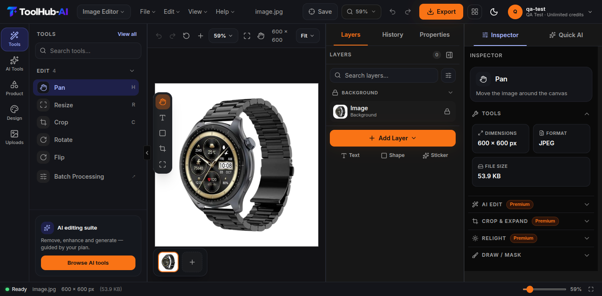 |

---

### 3. Integrated AI Image Studio & Background Segmentation
Deep generative AI integration allowing background removal (rembg U2-Net), AI relighting, generative fill, and instant product staging directly on active canvas layers.

| Generative AI Tool Rail | U2-Net Background Removal Panel |
|:---:|:---:|
| 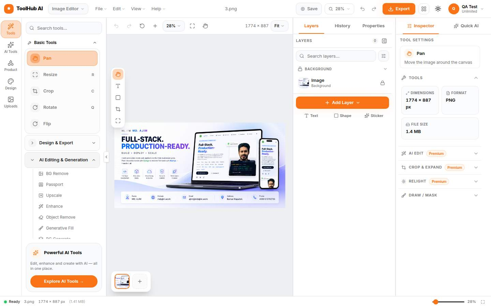 | 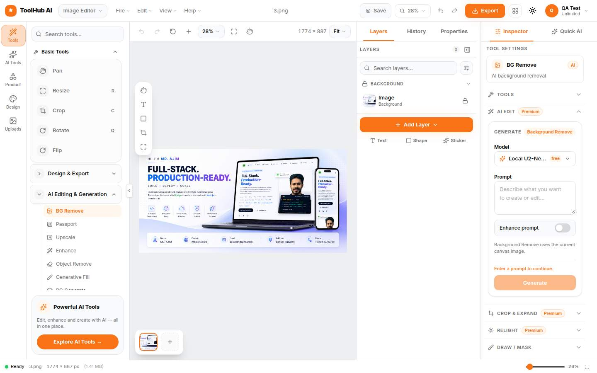 |

---

### 4. Models Directory & Multi-Provider Registry (`/ai/models`)
A transparent model catalogue displaying real-time provider health, capability matrices (reasoning, vision, function calling, audio), context window size, and pricing tiers.

| AI Model Ecosystem Directory | Smart Export & Multi-Format Presets |
|:---:|:---:|
| 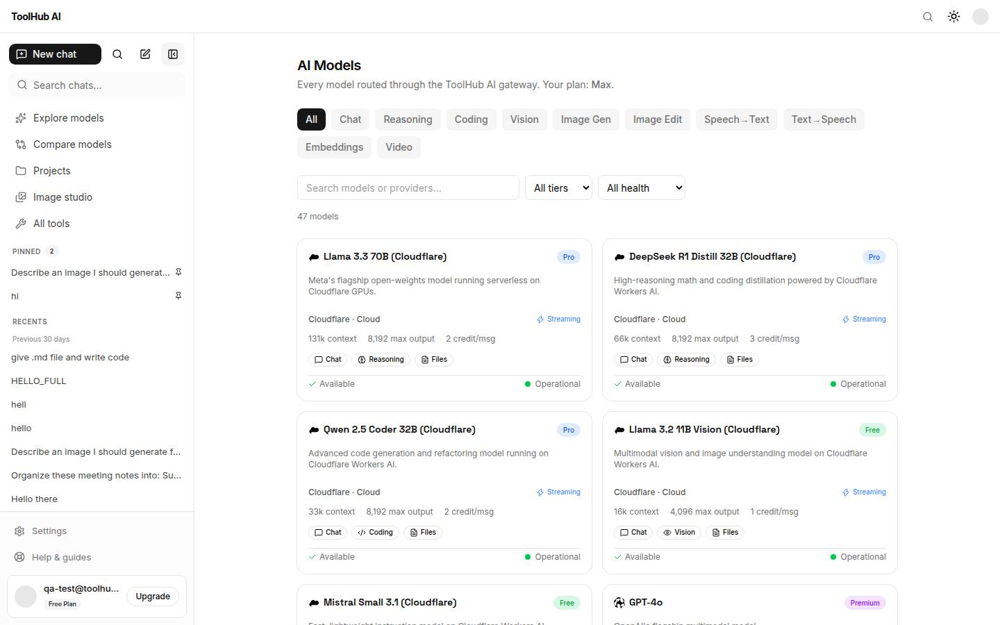 | 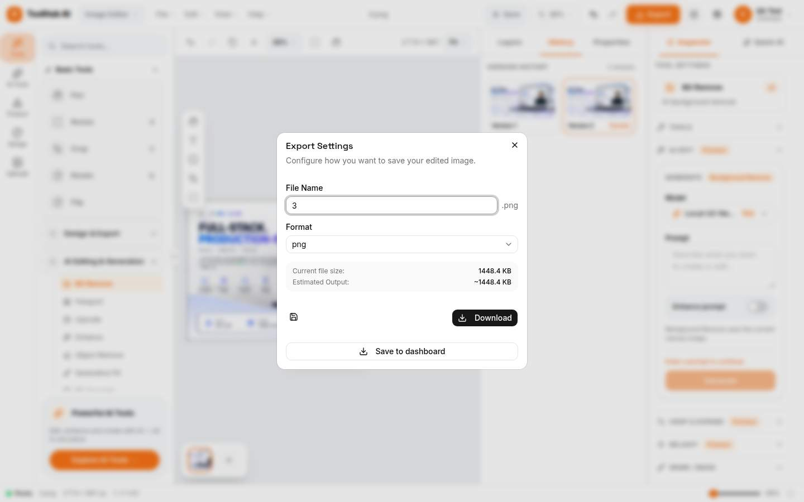 |

---

### 5. Production Dashboard, Analytics & Financial Billing (`/dashboard`)
Comprehensive user cockpit monitoring credit allocation, storage consumption, Celery task statuses, and multi-gateway billing history.

| Dashboard Analytics & Activity Feed | Subscriptions & Credit-Safe Billing Ledger |
|:---:|:---:|
| 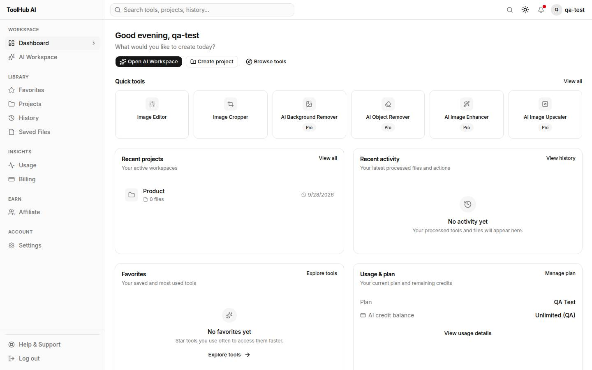 | 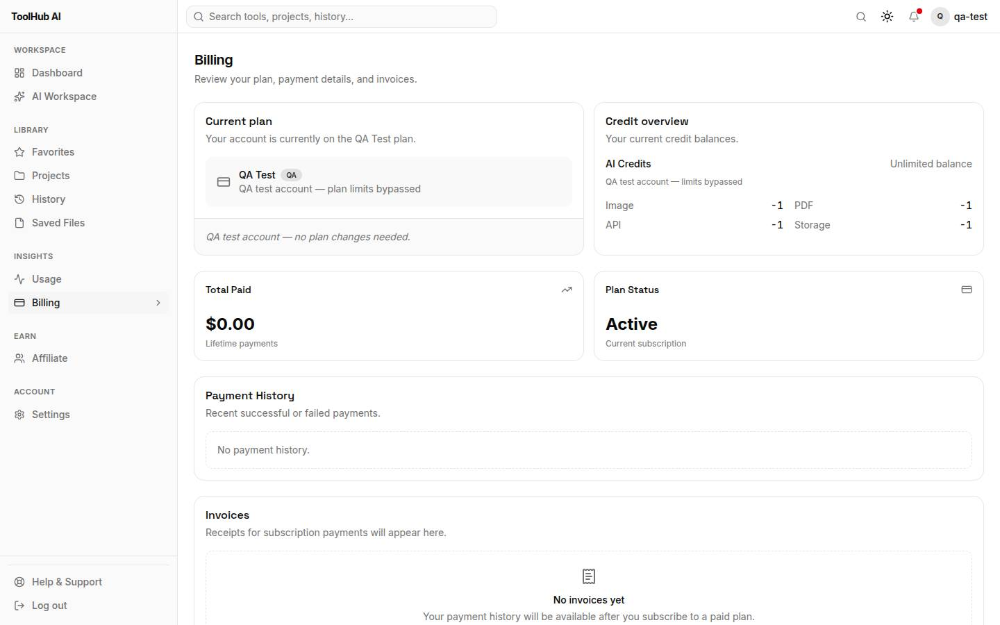 |

| Granular Credit Usage Telemetry | High-Throughput Batch Processing Engine |
|:---:|:---:|
| 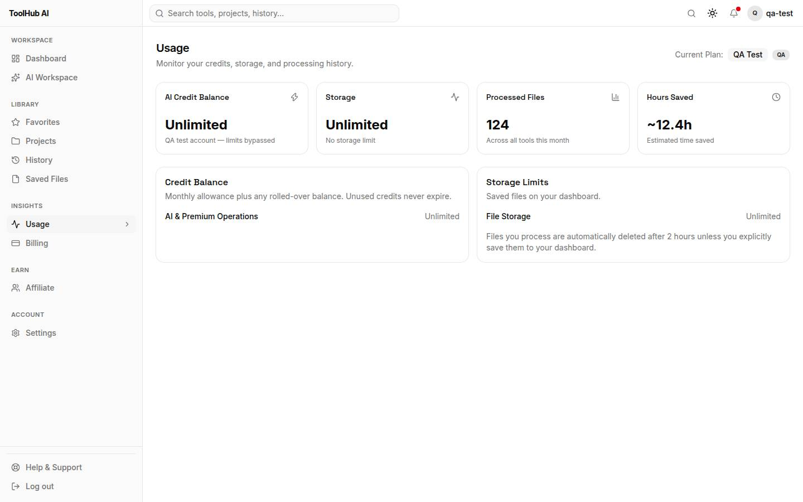 | 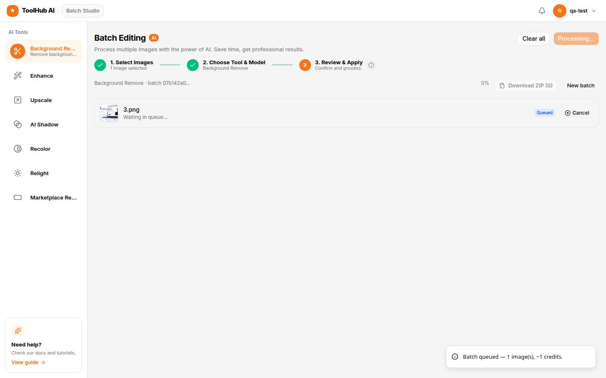 |

---

## 🏗️ System Architecture & Technical Diagrams

ToolHub-AI is built on an asynchronous, event-driven modular monolith architecture optimized for low-latency streaming, resilient third-party integrations, and strict financial consistency.

### 1. High-Level Multi-Tier System Topology

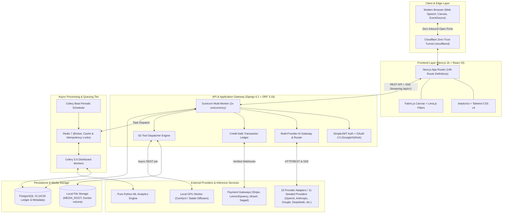

---

### 2. Multi-Provider AI Streaming & Abort Reconciliation Protocol

Handling generative AI streams requires handling mid-stream client disconnects and upstream provider failures gracefully without corrupting user credit balances.

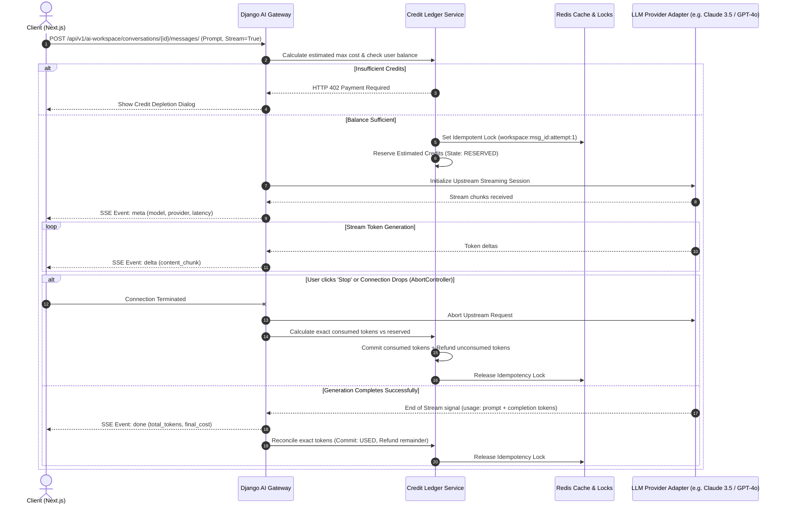

---

### 3. Credit-Safe Financial Ledger Architecture (`Reserve → Stream → Commit/Refund`)

To prevent duplicate billing and protect users against network drops, all transactions follow an idempotent two-phase settlement pattern:

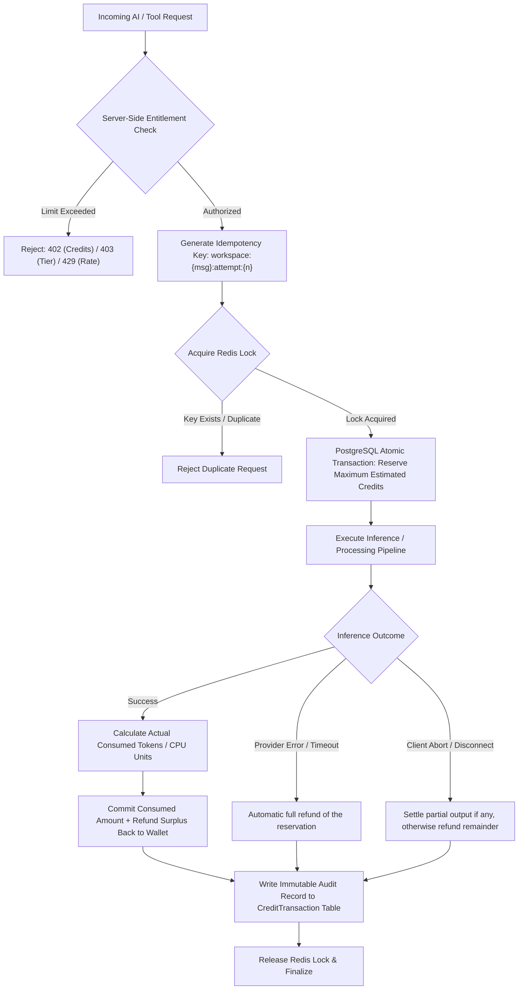

---

## ⚡ Core Engineering Innovations

### 1. Multi-Provider LLM Gateway with Resilient Auto-Routing
- **15 Standardized Provider Adapters:** Decoupled adapters translate heterogeneous upstream schemas (OpenAI, Anthropic Messages API, Google Gemini REST, DeepSeek, Mistral, Ollama) into a unified internal data contract.
- **Circuit Breaker & Live Verification (`verify_models --live`):** Paid selectors display only models that pass live synthetic round-trip verification. Degraded providers are automatically quarantined for 15 minutes.
- **Side-by-Side Model Compare (`/ai/compare`):** Uses an asynchronous thread-and-queue fan-out engine to stream responses from up to 3 models simultaneously, displaying real-time time-to-first-token (TTFT) and throughput comparisons.

### 2. Credit-Safe Ledger & Multi-Gateway Billing
- **Reserve-then-settle design:** a request reserves an estimated maximum, then commits the consumed amount and refunds the remainder (or refunds in full on upstream failure). The `Reserve → Stream → Commit/Refund` protocol is backed by Redis idempotency keys (`workspace:{msg_id}:attempt:{n}`), which is intended to prevent double-charging and credit leaks on mid-stream disconnects.
- **Server-Side Security Enforcement:** All plan entitlements, tool permissions, and burst rate limits are validated strictly on the backend (HTTP 402/403/429). The frontend never makes authorization decisions.
- **Hybrid Global & Emerging-Market Payment Engine:** Webhook-driven state machines support credit card subscriptions (Stripe, LemonSqueezy) alongside regional mobile wallets (bKash Tokenized Checkout, Nagad).

### 3. Layer-Based In-Browser Creative Studio (Fabric.js & Lena.js)
- **Non-Destructive Canvas Architecture:** Graphic editing is powered by an object-oriented canvas engine (Fabric.js 7) coupled with non-destructive canvas filters (Lena.js), supporting bounded undo/redo history (up to 50 steps), alignment guides, and layer reordering.
- **Brush-Mask Inpainting:** Users paint directly over canvas objects to create precise alpha-masks for generative inpainting or object removal.
- **eCommerce Automation Rail:** Specialized 1-click tools for product photography, ghost mannequin extraction, fashion model generation, and marketplace-compliant white balancing.

### 4. Comprehensive 62-Tool Cloud Utility Suite
- Consolidated tool suite across 15 mega-menu categories, counted from the frontend registry (`frontend/src/constants/centralToolRegistry.ts`; every entry is marked `available`):
  - **Image & AI creative tools (41):** Resizing, crop/rotate/flip, WebP/AVIF compression, passport photo generator, watermarking, background removal, inpainting, relighting, and product/e-commerce staging tools.
  - **PDF Operations (8):** Client- and server-side merging, page splitting, compression, password protection/unlock, and format conversion.
  - **Text, SEO & Developer Utilities (13):** Text cleaning, duplicate removal, QR code and favicon generation, link shortening, password generation, meta/Open Graph/robots/sitemap generators, and a resume builder.

---

## 🧠 Pure-Python Classical Machine Learning Engine

A standout engineering element in ToolHub-AI is its **pure-Python classical machine-learning library**, implemented from scratch without external ML frameworks like `scikit-learn` or `pandas`. This keeps the Docker image lean, makes training deterministic, and keeps every algorithm unit-testable without a database.

The library implements classic algorithms — ordinary-least-squares linear regression, CART decision trees, random forests, KNN, logistic regression, Gaussian Naive Bayes, a linear SVM, AdaBoost decision stumps, K-Means++ clustering, plus Count/TF-IDF text vectorizers and an evaluation/tuning toolkit. The workflow below shows how the four serving models consume the shared feature pipeline.

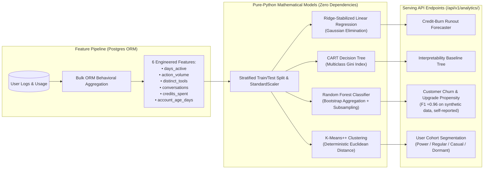

### Pure-Python Model Specifications:
1. **Ridge-Stabilized Linear Regression:** Built using Gaussian elimination with L2 ridge stabilization to avoid singular matrix inversion. Powers the **credit-depletion forecaster** and prompt token/latency cost estimators.
2. **CART Decision Trees & Random Forest:** Recursive binary splitting on multiclass Gini impurity, bootstrap aggregation, and permutation feature importance. A tuned random forest is reported to reach **F1 ≈0.96 on a synthetic churn dataset** (self-reported in `ML_IMPLEMENTATION_REPORT.md`; the repo ships no production benchmark, so treat this as an indicative figure, not a production SLA).
3. **K-Means++ Clustering:** Probabilistic distance-weighted initialization with deterministic seeding, used to cluster tool affinity (Jaccard co-occurrence matrix) and segment users into behavioral cohorts.
4. **Validation Suite:** 48 dedicated unit tests verify confusion-matrix metrics (macro precision, recall, F1), regression R² and MAE, tuning, and serialization round-trips. All 48 pass locally (see [Testing & QA](#-testing--quality-assurance)).

---

## 💻 Technology Stack Matrix

```
Frontend:
  ├── Framework: Next.js 16.3 (App Router, Turbopack)
  ├── Core: React 19.2, TypeScript 5.x
  ├── Styling: Tailwind CSS v4, shadcn/ui, Lucide Icons
  ├── Creative Canvas: Fabric.js 7, Lena.js (image filters), react-advanced-cropper
  └── Streaming & State: Server-Sent Events (SSE), React Context, next-themes

Backend & Distributed Services:
  ├── Language: Python 3.12
  ├── Web Framework: Django 6.1, Django REST Framework (DRF) 3.18
  ├── WSGI Server: Gunicorn (multi-worker process model)
  ├── Task Queuing: Celery 5.6 (distributed asynchronous execution)
  ├── Scheduler: Celery Beat (periodic ML retrain & ledger sync)
  ├── Caching & Locks: Redis 7 (server) / redis-py (in-memory broker, cache, idempotency locks)
  └── Database: PostgreSQL 15 (relational schema with ACID guarantees)

AI Inference & Media Engines:
  ├── Multi-Model Gateway: 15 registered provider adapters (OpenAI, Anthropic, Google, DeepSeek, etc.)
  ├── Local GPU Worker: ComfyUI (local Stable Diffusion pipeline, optional)
  ├── Image Processing: Pillow 12, rembg (U2-Net background removal), pypdf
  └── Custom Machine Learning: pure-Python classical ML library (no scikit-learn/pandas)

Security & Payment Infrastructure:
  ├── Authentication: SimpleJWT (token rotation + blacklist), Google & GitHub OAuth 2.0
  ├── Ingress Protection: optional Cloudflare Zero-Trust Tunnel profile (no exposed inbound backend ports)
  └── Payment Gateways: Stripe, LemonSqueezy, bKash (Tokenized), Nagad
```

---

## 📂 Project Organization & Directory Layout

The repository is structured as a scalable modular monolith cleanly separating domain logic:

```
ToolHub-AI/
├── frontend/                       # Next.js 16 App Router Frontend
│   ├── src/
│   │   ├── app/                    # 146 route definitions (marketing, /ai, /tools, /dashboard)
│   │   ├── components/
│   │   │   ├── ai-workspace/       # LLM chat composer, thread, model selector, compare
│   │   │   ├── editor/             # Fabric.js canvas, layers panel, filter controls, tool rail
│   │   │   ├── dashboard/          # Usage telemetry, billing cards, file browser
│   │   │   └── ui/                 # Accessible primitives built on shadcn/ui
│   │   ├── services/               # Strongly-typed API client SDKs
│   │   └── constants/              # Central registry of 62 tools, model capability matrix
│   └── public/                     # High-resolution screenshots, branding, vector assets
│
├── backend/                        # Django 6.1 REST Application
│   ├── apps/                       # 28 Django app modules (23 registered in INSTALLED_APPS)
│   │   ├── ai_workspace/           # 15 provider adapters, SSE streaming gateway, chat models
│   │   ├── subscriptions/          # Plans, credit wallets, atomic credit-transaction ledger
│   │   ├── billing/                # Webhook state machines (Stripe, LemonSqueezy, bKash, Nagad)
│   │   ├── analytics/              # Pure-Python ML library, churn prediction, user clustering
│   │   ├── authentication/         # JWT rotation, OAuth callbacks, OTP email verification
│   │   ├── image_tools/            # Pillow, rembg U2-Net image transformations
│   │   ├── pdf_tools/              # pypdf operations (merge, split, encrypt, convert)
│   │   └── developer_tools/        # QR generator, hash tools, code formatting APIs
│   ├── config/                     # Core settings, WSGI/ASGI handlers, Celery configuration
│   └── requirements/               # Dependency file (base.txt)
│
├── comfyui/                        # Local GPU workflow configurations & model weights
├── docs/                           # 90+ architecture specifications & QA audits
│   ├── 03-system-architecture.md   # System design & database specifications
│   ├── 11-payment-subscription-architecture.md  # Idempotent ledger & payment state machines
│   ├── 32-ai-multi-model-workspace-architecture-v2.0.md  # SSE gateway & adapter specification
│   └── qa/screenshots/             # Browser-test visual audit artifacts
├── docker-compose.yml              # 6-service container orchestration (+ optional cloudflared)
└── .env.example                    # Environment variable template
```

---

## 🚀 Quickstart & Local Development

### Option 1: Docker Compose (Recommended)

Run the full stack (Frontend, Backend/Gunicorn, Postgres, Redis, Celery worker, and Celery Beat) with a single command. The `backend`, `celery`, and `celery-beat` services run migrations and seed plans/models automatically on startup (see the `backend` service command in `docker-compose.yml`).

```bash
# 1. Clone the repository
git clone https://github.com/md-ajim/ToolHub-AI.git
cd ToolHub-AI

# 2. Configure environment credentials
cp .env.example .env
# Open .env and supply your SECRET_KEY and any AI/payment keys you need

# 3. Build and launch the 6 default services
docker compose up -d --build

# Access the app:
# Web app:  http://localhost:32768   (host port = FRONTEND_PORT, default 32768)
```

> **Networking note:** only the frontend is published to the host by default. Next.js reverse-proxies `/api/*` and `/media/*` to the `backend` service (see `frontend/next.config.ts`), so the REST API is reachable at `http://localhost:32768/api/v1/`. Django Admin (`/admin/`) is **not** exposed through that proxy; to use it, either run the backend natively (Option 2) or publish the backend port yourself. An optional `cloudflared` service is available via `docker compose --profile cloudflare up -d`.

*These Docker commands reflect the checked-in `docker-compose.yml`; they were not executed end-to-end during the documentation audit (no containers were started).*

---

### Option 2: Native Bare-Metal Development

#### Prerequisites
- Node.js 20+ & npm
- Python 3.12+
- PostgreSQL 15 & Redis 7 running locally (or `docker compose up -d db redis`)

#### 1. Backend Setup (Django + Celery)
```bash
cd backend
python -m venv venv
source venv/bin/activate  # On Windows: venv\Scripts\activate

pip install -r requirements/base.txt
cp ../.env.development .env

# Run database migrations and seed plans + AI models
python manage.py migrate
python manage.py seed_plans
python manage.py seed_ai_models
# Optional: seed e-commerce marketplace presets
python manage.py seed_marketplace_presets

# Start the API server
python manage.py runserver 0.0.0.0:8000
```

In a separate terminal, launch the background task worker:
```bash
cd backend
source venv/bin/activate
celery -A config worker --loglevel=info
```

#### 2. Frontend Setup (Next.js 16)
```bash
cd frontend
npm install
npm run dev
# With the backend on :8000, set BACKEND_URL=http://localhost:8000 so the
# dev server proxy can reach it, then open http://localhost:3000
```

---

## 🧪 Testing & Quality Assurance

The repository ships unit tests on both sides of the stack. Commands and *locally observed* results from this audit are listed below; results depend on your environment.

| Suite | Command | Result observed |
|---|---|---|
| Frontend (Vitest) | `cd frontend && npm test` (`vitest run`) | **204 passed** across 30 test files |
| Backend ML suite (pytest) | `cd backend && pytest tests/unit/apps/analytics/test_ml_suite.py` | **48 passed** |
| Backend (full) | `cd backend && pytest` | **700 tests collected**; full execution was **not completed** here (it expects PostgreSQL/Redis services, and an incomplete run surfaced service-dependent failures) |
| Frontend lint | `cd frontend && npm run lint` (`eslint`) | not run in this audit |

The frontend suite (`frontend/src/constants/toolRegistry.test.ts` and editor component tests) asserts that every tool-rail id resolves to a known registry entry and backend operation. The backend ML suite covers confusion-matrix metrics, regression error metrics, hyperparameter tuning, and serialization round-trips.

---

## 🔒 Security & Hardening Highlights

- **Reduced inbound attack surface:** deployed with the optional **Cloudflare Tunnel (`cloudflared`)** compose profile, the stack is reachable from the Cloudflare edge without publishing the backend directly to the host. (This is a deployment pattern, not a claim about any specific live environment.)
- **Defensive JWT authentication:** 60-minute access tokens with refresh-token rotation and blacklisting on rotation/logout (`rest_framework_simplejwt.token_blacklist`).
- **Payment webhook verification:** Stripe and LemonSqueezy webhooks are verified via HMAC/secret signature checks, and duplicate events are de-duplicated through database-level idempotency records (`billing/webhooks_multi.py`).
- **Server-enforced entitlements:** plan access, tool permissions, and rate limits are validated on the backend (HTTP 402/403/429); the frontend does not make authorization decisions.
- **Sandboxed content rendering:** AI Markdown is rendered by a custom structured renderer that emits React nodes and shows raw HTML in a sandboxed preview — it is never injected into the application DOM (`frontend/src/components/ai-workspace/MarkdownContent.tsx`).

---

## 📐 Metric Verification Notes

The headline numbers in this README were re-measured from the checked-in source during a documentation audit. Method and caveats:

| Metric | Value | How it was measured |
|---|---|---|
| TypeScript/TSX LOC | ≈66,000 | `git ls-files 'frontend/src/**/*.ts' 'frontend/src/**/*.tsx' \| xargs wc -l` |
| Python LOC | ≈47,000 | `git ls-files 'backend/**/*.py' \| xargs wc -l` (includes migrations and tests) |
| Frontend routes | 146 | count of `page.tsx` files under `frontend/src/app` |
| API endpoints | ≈190 | `path()`/`re_path()` patterns across app `urls.py` modules (config includes excluded from the app count) |
| Django apps | 28 modules / 23 registered | app directories containing `apps.py`; `INSTALLED_APPS` in `config/settings/base.py` |
| Seeded models / providers | 62 / 11 | `backend/apps/ai_workspace/management/commands/seed_ai_models.py` |
| Provider adapters | 15 | `PROVIDER_ADAPTERS` in `backend/apps/ai_workspace/providers/__init__.py` (includes a mock test adapter) |
| Registered tools | 62 | `CENTRAL_TOOL_REGISTRY` in `frontend/src/constants/centralToolRegistry.ts` (all `available`; live site shows "62 tools") |
| AI image operations | 31 | `OPERATION_REGISTRY` in `backend/apps/ai_tools/registry.py` |

**Claim classifications:**
- **Verified from source:** route/LOC/app/registry counts above; library versions in `frontend/package.json` and `backend/requirements/base.txt`; 48 ML tests passing locally; 204 frontend tests passing locally.
- **Self-reported (not independently benchmarked):** the Random Forest **F1 ≈0.96** figure, which originates in `ML_IMPLEMENTATION_REPORT.md` and is described there as measured on *synthetic* churn data.
- **Deployment claims** (Cloudflare Tunnel, production reliability) describe intended/optional deployment topology and are not claims about any specific live environment.
- **Not run in this audit:** `docker compose up` for the full stack, and the complete backend pytest suite (requires PostgreSQL + Redis).

---

## 👨‍💻 About the Author & Contact

**MD AJIM**  
*Full-Stack Systems Engineer (Django | Next.js | Distributed AI | DevOps)*  
Barisal, Bangladesh • Open to Global Relocation & Remote Opportunities  

- 🌐 **Portfolio Website:** [mdajim.work](http://mdajim.work)
- 💼 **LinkedIn Profile:** [linkedin.com/in/md-ajim](https://www.linkedin.com/in/md-ajim/)
- 🐙 **GitHub Profile:** [github.com/md-ajim](https://github.com/md-ajim)
- 📧 **Direct Email:** [ajim@mdajim.work](mailto:ajim@mdajim.work)

---

<div align="center">

*Engineered with precision for performance, security, and developer joy.*

</div>
